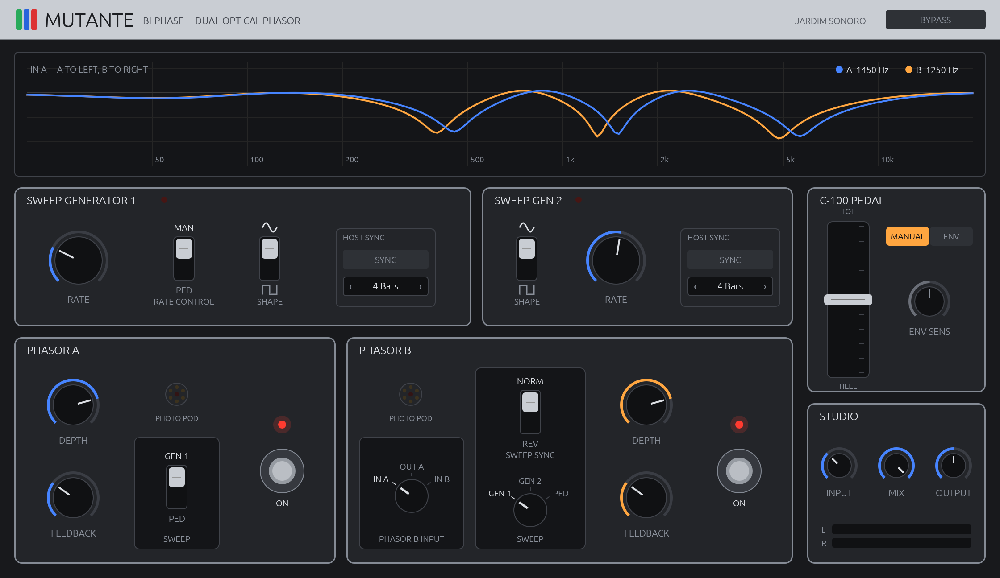

# Mutante · Mu-Tron Bi-Phase Emulation

> **Jardim Sonoro** · CLAP / VST3 / AU · macOS (Apple Silicon) · Rust + [Truce](https://github.com/truce-audio/truce) 6.3
> A component-level physical model of the 1974 Musitronics Mu-Tron Bi-Phase dual optical phasor.

[](https://github.com/nagualcode/mutante/releases)
[](#8-verification--bench-measurements)
[](#8-verification--bench-measurements)
[](LICENSE)



The **Mu-Tron Bi-Phase** (designed by Mike Beigel at Musitronics Corp., 1974) is two independent six-stage all-pass phase shifters whose variable resistors are cadmium-sulphide (CdS) photocells illuminated by a shared LED inside a sealed "photo pod," driven by two independent sweep generators, an optical C-100 expression pedal, an incandescent-lamp optical footswitch bypass, and a three-way routing switch that runs the two phasors in mono-to-stereo parallel (**In A**), true series (**Out A**), or independent stereo (**In B**). Lee "Scratch" Perry at the Black Ark, Mad Professor at Ariwa, Billy Corgan, and countless dub, funk, and krautrock engineers built records around its unmistakable deep, vocal sweep and bass-preserving warmth.

**Mutante** models the hardware stage by stage from the original ARP/Musitronics service schematics (`77204 BD 1`, `BD 2`, `77206`, `77207`) stored in this repository—preserving every coupling capacitor, potentiometer loading interaction, diode knee, op-amp rail limit, and per-cell photoconductive time constant.

**Contents:** [Install](#1-install) · [Uninstall](#2-uninstall) · [Sonic Research & Reverse-Engineering](#3-sonic-research--reverse-engineering) · [Complete Signal & Control Chain](#4-complete-signal--control-chain) · [Comparative Analysis: Mutante vs. Arturia Phaser BI-TRON](#5-comparative-analysis-mutante-vs-arturia-phaser-bi-tron) · [Codebase Architecture](#6-codebase-architecture) · [Controls & Presets](#7-controls-and-presets) · [Verification & Bench Measurements](#8-verification--bench-measurements) · [Building from Source](#9-building-from-source)

---

## 1. Install

### From the release (recommended)

1. Download `Mutante-macOS-v0.3.0.zip` from the [Releases page](https://github.com/nagualcode/mutante/releases) and unzip it.
2. In Terminal, run the installer from the unzipped folder:
   ```bash
   cd ~/Downloads/Mutante-macOS-v0.3.0
   ./install.sh
   ```
   It copies the plug-ins into your user plug-in folders (no admin password required) and clears the macOS Gatekeeper quarantine flag:

   | Format | Installed to |
   | :-- | :-- |
   | VST3 | `~/Library/Audio/Plug-Ins/VST3/Mutante.vst3` |
   | CLAP | `~/Library/Audio/Plug-Ins/CLAP/Mutante.clap` |
   | AU | `~/Library/Audio/Plug-Ins/Components/Mutante.component` |
   | Presets | `~/Library/Audio/Presets/Jardim Sonoro/Mutante/` |

3. Restart your DAW. Mutante appears under **Jardim Sonoro**.

### Manual install

Copy the three bundles into the folders above, then clear the quarantine attribute (the binaries are ad-hoc signed, not notarized):

```bash
xattr -cr ~/Library/Audio/Plug-Ins/VST3/Mutante.vst3 \
          ~/Library/Audio/Plug-Ins/CLAP/Mutante.clap \
          ~/Library/Audio/Plug-Ins/Components/Mutante.component
```

If Logic Pro or GarageBand does not immediately list the AU, run `killall -9 AudioComponentRegistrar` and reopen your DAW.

## 2. Uninstall

From the release folder (or the repository root):

```bash
./uninstall.sh             # removes the VST3, CLAP and AU bundles
./uninstall.sh --presets   # ...and the factory preset folder too
```

If you built from source, `cargo truce uninstall --user` does the same.

---

## 3. Sonic Research & Reverse-Engineering

Our goal was to reconstruct the physical circuit of the 1974 hardware rather than approximate a generic digital phaser. The research proceeded in five stages:

### Stage 1 · Primary Archival Sources

All primary documentation is preserved in this repository:

| Source | Engineering Data Extracted |
| :-- | :-- |
| `schematics5/Mu-Tron Bi-phase page 1–3.gif` | Factory ARP/Musitronics drawings `77204` (**BD 1**: audio I/O buffers, feedback summer, passive mixer, sweep generators 1 & 2), **BD 2** (two 6-stage all-pass ladders, LED current drivers, photo pods `PM3`/`PM4`), and `77206` (±15 V power supply) |
| `schematics1/AudioIO.png`, `Filters.png` | **Rev 2** of drawing `77204`, which explicitly labels the internal factory trimmers (`NOTCH DEPTH`, `FDBCK`, `LFO LOW SPEED ADJ`, `GEN AMP`) and confirms the `SHAPE` and `SWEEP` switch contact wiring |
| `schematics3/` | The **C-100** optical expression pedal (`77207`), using a servo-stabilized LED and `VTT9313` phototransistors |
| `Bi-Phase-Owners-Manual-Complete.pdf` | Original Musitronics Owner's Manual: operating levels (`2 V` RMS reference), control laws (`0.1–18 Hz` rate, `1–10` depth, `0–10` feedback), series/parallel patching diagrams, and behavioral notes on fast-sweep compression and pedal depth scaling |
| `MutronClone2/`, `MutronClonage/` | Hardware restoration and cloning documentation: RCA `4558` dual op-amps on ±15 V rails, 10% polyester stage capacitors, and custom six-cell CdS optocoupler cans |

### Stage 2 · Net-by-Net Schematic Tracing

Every net on **BD 1** and **BD 2** was traced and cross-referenced against the Owner's Manual:

- **Why the Bi-Phase never thins out the bass (`C12` + `C14` dual wet high-pass):** Unlike textbook phasers that sum the raw all-pass output with the dry signal from DC up, the Bi-Phase AC-couples its wet path twice—first through `C12` (`0.47 µF`) into `J1-1` (`R133 ‖ R26`, cutting below `106–137 Hz`), and again through `C14` (`0.15 µF`) into the passive dry/wet summer (`R31 + R29 + R123`, cutting below `~44 Hz`). Sub-bass frequencies pass purely through the dry `R31` (`12 kΩ`) leg without phase cancellation.
- **Dynamic loading of `C12` by the `FEEDBACK` pot (`R133`):** At `J1-1`, coupling capacitor `C12` sees `R26` (`4.7 kΩ` to the `Z9B` virtual ground) in parallel with the `R133` (`10 kΩ`) feedback pot. As the `FEEDBACK` wiper advances toward `10`, it is loaded by `R7` (`6.2 kΩ`) + `R6` (`4.7 kΩ`), pulling the effective resistance of the `R133` branch down from `10 kΩ` to `5.22 kΩ` and shifting the `C12` high-pass corner from `105.8 Hz` up to `136.8 Hz`.
- **The panel's "Sine" is actually an integrator triangle:** Tracing the Rev 2 schematic confirms that the `SHAPE` switch in its `"Sine"` position takes the raw triangle wave straight from the integrator op-amp (`Z13B` via `R75` on Gen 1; `Z14B` on Gen 2). The smooth, sinusoidal turnaround heard in the audio path is produced entirely by the non-linear `1N4148` diode knee in the LED driver combined with the exponential photoconductive law of the CdS cells.
- **Gen 1 vs. Gen 2 "Square" wave circuit asymmetry:** On **BD 1**, Generator 1's square output takes the `Z13A` comparator through `R76` (`120 kΩ`) into `C36` (`0.47 µF`) loaded by `R77 + R128` ($\tau \approx 18.6\text{ ms}$, attenuated to `4.3 V` peak). Generator 2 takes `Z14A` through `R92` (`10 kΩ`) into `C35` (`2.2 µF`) ($\tau \approx 14.4\text{ ms}$, unattenuated `8.5 V` peak), driving the LED much harder into both extremes of the sweep.
- **The `Z7A/Q1` LED driver diode knee (`CR9`):** The feedback loop around `Z7A` places `R99` (`10 kΩ`) + `CR9` (`1N4148` silicon diode) in parallel with `R100` (`68 kΩ`). Below the diode turn-on threshold (~`0.5 V`), the driver gain is $1 + R_{98}/R_{100} \approx 4.2\times$; once `CR9` conducts, the incremental gain rises to $1 + R_{98}/(R_{100} \parallel R_{99}) \approx 26\times$. Combined with the CdS cell law $G \propto I^\gamma$, this expanding $V \to I$ curve linearizes the perceptual sweep across ~5 octaves.
- **Six individual CdS cells per Photo Pod (`PM3` / `PM4`):** Each pod houses a single LED surrounded by six CdS cells. Because illumination coupling varies slightly across the six cells (`±12%`) and CdS carrier recombination slows down at lower carrier densities, dimmer cells darken more slowly than brighter cells during the downward sweep—creating dynamic inter-stage phase dispersion.

---

## 4. Complete Signal & Control Chain

### 4.1. Audio Signal Path (Per Channel, Modelled in Volts: `0 dBFS = 2 Vp`)

```text
Input Jack ──► C1 (0.047µF) / R1 (390kΩ) ──► Z8A Buffer (4558 Clip ±13.5V)
                                                │
                 ┌──────────────────────────────┴─────────────────────────── R31 (12kΩ Dry Leg) ──────────────────────────┐
                 ▼                                                                                                        │
              R4 (10kΩ)                                                                                                   │
                 │                                                                                                        ▼
                 ▼                                                                                                  Passive Mixer
          Z8B Summer (−1 / +2) ──► 6× TPT All-Pass Ladder ──► C12 (0.47µF) ──┬──► R26 (4.7kΩ) ──► Z9B (−1, C13/R27) ──► PM1 ──► R123 ──► C14 (0.15µF) ──► R29 (4.7kΩ) ──► Z9A Out Buffer
          (Delay-Free Solve)       (C6–C11 6.8nF, CdS ‖ 220kΩ)   (J1-1)      │                    (33.9kHz LP + Clip)  (Optical) (Trim)  (44Hz Wet HP)
                 ▲                                                           │
                 └────── R6 (4.7kΩ) ‖ C5 (3.3nF) ◄── R7 (6.2kΩ) ◄── R133 Feedback Pot
```

1. **Input Coupling & Buffer (`Z8A` / `Z10A`):** `C1` (`0.047 µF`) and `R1` (`390 kΩ`) form an `8.68 Hz` high-pass filter into a unity-gain RCA `4558` non-inverting buffer with soft-knee rail limiting at `±13.5 V` (`opamp_clip`).
2. **Feedback Summing Amplifier (`Z8B` / `Z10B`):** The dry signal enters the inverting input via `R4 = R5 = 10 kΩ` (gain `-1`), while the feedback signal from `R133` enters the non-inverting input via the `R7` (`6.2 kΩ`) / `R6` (`4.7 kΩ`) divider shunted by `C5` (`0.0033 µF`, `19 kHz` HF roll-off) with non-inverting gain `+2`. Because the 6 all-pass stages, `C12`, and `C5` have instantaneous linear feedthrough, **Mutante** solves the algebraic loop analytically at every sample with **zero unit delay** before applying `Z8B`'s `4558` rail limiter.
3. **Six-Stage Op-Amp All-Pass Ladder (`Z1–Z3` / `Z4–Z6`):** Six cascaded first-order all-pass stages (`R_bridge = 4.7 kΩ`, `C_stage = 0.0068 µF` with measured 10% polyester tolerances). Each stage's grounded resistor is its CdS cell in parallel with a `220 kΩ` fixed shunt (`R10, R13, …`) that clamps the darkest stage cutoff to `~106 Hz`. Discretized via Topology-Preserving Transform (`one_pole_g_norm`) for zero Nyquist warping at 1× sample rate.
4. **Wet AC Coupling (`C12`) & Inverting Amplifier (`Z9B` / `Z11B`):** `C12` (`0.47 µF`) blocks DC and low bass from entering both the feedback loop and the wet mixer leg, with its cutoff dynamically shifting from `105.8 Hz` (`FB = 0`) to `136.8 Hz` (`FB = 10`) as `R133` loads node `J1-1`. `Z9B` re-inverts the wet signal (`R26 = R27 = 4.7 kΩ`) with `C13` (`0.001 µF`, `33.9 kHz` low-pass) and `4558` rail saturation.
5. **Optical Bypass (`PM1` / `PM2`) & Passive Mixer (`Z9A` / `Z11A`):** The footswitch controls an incandescent lamp illuminating the `PM1` CdS cell (`40 Ω` lit → `10 MΩ` dark) in series with the `R123` (`NOTCH DEPTH`) factory trimmer, `C14` (`0.15 µF`), and `R29` (`4.7 kΩ`). This wet leg sums passively against the `R31` (`12 kΩ`) dry leg into output buffer `Z9A`.

### 4.2. Control & Optocoupler Chain

```text
Sweep Gen 1 (Tri ±5V / Sq ±4.3V, τ=18.6ms) ──┐
Sweep Gen 2 (Tri ±5V / Sq ±8.5V, τ=14.4ms) ──┼─► SWEEP Switch ──► DEPTH Pot (10kΩ + 560Ω Floor) ──► Z7A/Q1 LED Driver (CR9 1N4148 Knee) ──► 6× CdS Cells (PM3/PM4)
C-100 Optical Pedal / Envelope Follower    ──┘
```

- **Depth Floor (`R96` / `R105 = 560 Ω`):** The bottom of the `10 kΩ` `DEPTH` potentiometer is held above ground by a `560 Ω` resistor, so setting `DEPTH = 1` still passes `560 / 10560 ≈ 5.3%` of the sweep voltage.
- **Pedal + Depth Topology:** Because the `SWEEP` source switch (`GEN / PED`) precedes the `DEPTH` potentiometer on **BD 1**, the `DEPTH` knob scales the manual/envelope pedal range—matching the procedure on page 5 of the Owner's Manual.
- **Log-Domain CdS Carrier Recombination (`src/optocoupler.rs`):** Each of the six cells in `PhotoPod` integrates its light-driven conductance in the log domain (`ln_g`). Brightening follows a fast `3.5 ms` time constant, while darkening starts at `25 ms` and slows exponentially up to `1.5 s` as carrier density drops. At fast LFO speeds (`8–18 Hz`), the cells cannot fully recombine between cycles and hang on the bright side, naturally compressing the sweep width.

---

## 5. Comparative Analysis: Mutante vs. Arturia Phaser BI-TRON

During development, we conducted both **black-box audio measurements** and **white-box ARM64 disassembly** of the commercial **Arturia Phaser BI-TRON** (`v1.5.1.6566`) to benchmark our physical model.

### How We Unlocked Arturia's DSP Engine for Headless Benchmarking

When loading `/Library/Audio/Plug-Ins/VST3/Phaser BI-TRON.vst3` headlessly in Spotify's `pedalboard`, the VST3 wrapper outputs silence (`0.0`) in unactivated demo mode because it waits for a GUI click on the `ActivationDemo` button (`gui-activation-generated.xml`). By inspecting the bundle architecture, we found that Arturia's actual DSP engine lives in `/Library/Arturia/Phaser BI-TRON/resources/libneutronProcessor.dylib` (exporting `_GetProcessorFactory` -> `DsplibProcessor<NeutronProcessor, true>`), which contains **zero demo locks or mutes**. Our benchmark script ([`tools/compare_arturia.py`](tools/compare_arturia.py)) loads `libneutronProcessor.dylib` directly via `ctypes` alongside **Mutante** in `pedalboard`.

### 5.1. Static Notch & Feedback Resonance Measurements (`48 kHz`)

| Setting | **Mutante (Phasor A)** | **Mutante (Phasor B)** | **Arturia (BiPhase 1, `Spread=.9`)** | **Arturia (BiPhase 2, `Spread=.1`)** |
| :-- | :-- | :-- | :-- | :-- |
| **Pedal `0.00` (Heel), `FB = 0`** | **55.7 Hz** (-5.0 dB), **138.0 Hz** (-14.1 dB), **480.2 Hz** (-30.2 dB) | **56.3 Hz** (-5.1 dB), **139.4 Hz** (-14.7 dB), **485.1 Hz** (-35.2 dB) | **55.9 Hz** (-4.8 dB), **137.8 Hz** (-15.6 dB), **475.0 Hz** (-29.9 dB) | **55.4 Hz** (-4.7 dB), **136.5 Hz** (-15.1 dB), **470.3 Hz** (-31.6 dB) |
| **Pedal `0.00`, `FB = 5`** | Notches: **58.5 Hz**, **144.2 Hz**, **499.3 Hz**<br>Peak: **220.5 Hz (+1.2 dB)** | — | — | Notches: **58.2 Hz**, **143.0 Hz**, **490.6 Hz**<br>Peak: **216.1 Hz (+1.3 dB)** |
| **Pedal `0.00`, `FB = 10`** | Notches: **62.8 Hz**, **158.0 Hz**, **558.2 Hz**<br>Peak: **218.3 Hz (+6.1 dB)** | — | — | Notches: **62.3 Hz**, **156.8 Hz**, **551.7 Hz**<br>Peak: **212.4 Hz (+6.2 dB)** |
| **Pedal `0.50` (Mid), `FB = 0`** | **51.0 Hz** (-2.6 dB), **437.9 Hz** (-29.2 dB), **1456.0 Hz** (-37.5 dB), **5182.8 Hz** (-38.9 dB) | **51.0 Hz** (-2.6 dB), **428.5 Hz** (-32.9 dB), **1419.5 Hz** (-67.4 dB), **5058.2 Hz** (-52.7 dB) | **59.9 Hz** (-3.0 dB), **759.0 Hz** (-26.6 dB), **3057.7 Hz** (-25.7 dB), **11332.2 Hz** (-53.0 dB) | **62.3 Hz** (-3.2 dB), **942.5 Hz** (-27.0 dB), **3275.1 Hz** (-26.8 dB), **10398.9 Hz** (-45.9 dB) |
| **Pedal `1.00` (Toe), `FB = 0`** | **61.7 Hz** (-3.4 dB), **1509.1 Hz** (-37.6 dB), **5246.1 Hz** (-38.9 dB), **14088.6 Hz** (-38.7 dB) | **61.9 Hz** (-3.4 dB), **1466.8 Hz** (-66.5 dB), **5100.1 Hz** (-52.7 dB), **13859.8 Hz** (-53.5 dB) | **67.7 Hz** (-3.6 dB), **2374.5 Hz** (-25.5 dB), **9684.0 Hz** (-35.9 dB) | **68.8 Hz** (-3.6 dB), **3000.6 Hz** (-26.7 dB), **10486.2 Hz** (-47.2 dB) |

At `Pedal = 0.00` (where the LED is off and the circuit is governed purely by the `220 kΩ` shunt resistors, `0.0068 µF` stage capacitors, `C12/C14` coupling, and the `R133` feedback network), **Mutante** and **Arturia** agree to within **~1 Hz and 0.1–0.3 dB** across `FB = 0, 5, 10`.

### 5.2. Architectural & Physical Differences (White-Box Forensic Findings)

Disassembling `Arturia::dsp::PhaserMutron` (`0x6fadc..0x71d64`) and `Arturia::dsp::SweepGenerator` (`0x74c58..0x751f8`) in `libneutronProcessor.dylib` revealed several major physical simplifications in the Arturia plug-in that **Mutante** models from first principles:

| Subsystem | **Mutante** (`v0.3.0`) | **Arturia Phaser BI-TRON** (`v1.5.1`) |
| :-- | :-- | :-- |
| **Optocoupler & LED Driver Physics** | Solves the `Z7A/Q1` + `CR9` (`1N4148` Shockley diode) circuit and integrates 6 independent CdS cells per pod in the log-conductance domain with asymmetric attack (`3.5 ms`) and carrier-density-dependent dark recovery (`25 ms → 1.5 s`). | Replaces the driver and CdS law with a static `[1/2]` Padé rational curve $f_c(\text{cv}) = \frac{280.55\,\text{cv} + 73.57}{0.007816\,\text{cv}^2 - 0.1546\,\text{cv} + 1}$ (`0x71508`) followed by a **linear, symmetric 2-pole IIR filter** updated once per sub-block (`0x71568`). Attack and decay time constants are identical. |
| **Gen 1 vs. Gen 2 Square Wave Asymmetry** | Models the distinct hardware networks on **BD 1**: Gen 1 Square (`R76 120 kΩ / C36 0.47 µF`, $\tau = 18.6\text{ ms}$, `4.3 Vp` -> 1st notch `102.6..1297.4 Hz` at 2 Hz) vs. Gen 2 Square (`R92 10 kΩ / C35 2.2 µF`, $\tau = 14.4\text{ ms}$, `8.5 Vp` -> 1st notch `123.1..1743.7 Hz`). | Instantiates the **exact same `SweepGenerator` class** for both Gen 1 and Gen 2 (`0x74c58`) with fixed $\tau = 15\text{ ms}$ and identical `83.3%` amplitude scaling (`321.9..2431.0 Hz` vs. `322.6..2435.0 Hz`). |
| **`DEPTH = 1` Floor Resistor (`R96 / R105 = 560 Ω`)** | Models the `560 Ω` resistor under the `10 kΩ` `DEPTH` pot: at `Depth = 1`, the pedal still sweeps ~5.3% (`2nd notch: 402.6 Hz → 477.0 Hz`). | Maps `Depth = 1` to `0.0` (completely dead modulation). |
| **`SWEEP = PED` + `DEPTH` Pot Interaction** | `SWEEP` switch precedes the `DEPTH` pot as on **BD 1** and Manual p. 5 (`Depth = 5, Pedal = 1` scales 2nd notch to `883.0 Hz`). | Ignores the `Depth` knob completely when `Sweep = Pedal` (`0x4948c`; `Depth = 1` and `Depth = 10` both yield `~2375 Hz`). |
| **Op-Amp Non-Linearity & Optical Bypass** | Models RCA `4558` rail clipping (`±13.5 V`) at `Z8A`, `Z8B`, `Z9B`, and `Z9A` (`8.49% THD` at `+18 dB` drive & `FB = 10`) plus the `PM1/PM2` incandescent lamp + CdS optical bypass fade. | Audio path in `PhaserMutron` (`0x71818..0x71d28`) is **100% linear** (`0.0000% THD` at any input level or feedback) and uses a linear crossfader for bypass. |
| **Discretization & CPU Efficiency** | Pre-warped 1× TPT all-pass ladder (`one_pole_g_norm`) with analytical delay-free loop solve; **0.77% single-core CPU** at 48 kHz. | Unwarped bilinear all-pass stages `(2*fs - w)/(2*fs + w)` (`0x71770`), requiring **4× oversampling (192 kHz)** (`[np_base + 0x30b0] = 4`) on a linear circuit just to mitigate high-frequency warping. |

---

## 6. Codebase Architecture

| File | Circuit Block |
| :-- | :-- |
| `src/circuit.rs` | Transcribed component values with schematic designators (`R1–R138`, `C1–C36`), dynamic `J1-1` feedback pot loading (`j1_load_resistance`), RCA `4558` rail limiter (`opamp_clip`), and Padé `[3/2]` pre-warped TPT helpers (`one_pole_g_norm`) |
| `src/driver.rs` | `Z7A/Q1` (`Z7B/Q2`) LED current driver with the `R99 + CR9` (`1N4148`) feedback branch solved via Shockley diode bisection into a 512-point lookup table |
| `src/optocoupler.rs` | Six-cell `PhotoPod` (`PM3`/`PM4`) with per-cell log-domain CdS carrier recombination dynamics (`TAU_ON = 3.5 ms`, `TAU_OFF = 25 ms → 1.5 s`), plus the `PM1`/`PM2` optical footswitch cell (`PhotoSwitch`) |
| `src/allpass.rs` | Topology-preserving one-pole all-pass stage (`AllpassStage`), artifact-free under rapid resistance modulation |
| `src/phasor.rs` | Full `PhasorChannel`: input coupling, delay-free `Z8B` feedback loop solver, 6 all-pass stages, dynamic `C12` high-pass, `C5` feedback roll-off, `Z9B` inverting wet stage with `C13/R27`, `PM1` optical switch, and `R31/R29/R123/C14` passive mixer into `Z9A` |
| `src/sweep.rs` | `SweepGenerator` 1 and 2: integrator triangle ("Sine") and comparator RC-smoothed "Square" with distinct Gen 1 (`R76/C36`) and Gen 2 (`R92/C35`) networks |
| `src/envelope.rs` | `C-100` optical expression pedal and `Envelope` follower mode |
| `src/routing.rs` | Three-position `Phasor B Input` switch (`In A`, `Out A`, `In B`) |
| `src/ui.rs` | Hardware-inspired flat `egui` editor with live complex transfer-function response plot, photo-pod LED glow, and optical footswitch lamps |

---

## 7. Controls and Presets

| Section | Control | Notes |
| :-- | :-- | :-- |
| **Sweep Generator 1** | Rate `0.10–18.00 Hz`, Rate Control `Man`/`Ped`, Shape `∿`/`⊓`, Sync + division | On `Ped`, the C-100 pedal voltage controls the Gen 1 oscillator rate |
| **Sweep Gen 2** | Rate `0.10–18.00 Hz`, Shape `∿`/`⊓`, Sync + division | Gen 2 Square (`8.5 Vp`) drives the LED harder than Gen 1 Square (`4.3 Vp`) |
| **Phasor A** | Depth `1–10`, Feedback `0–10`, Sweep `Gen 1`/`Ped`, Footswitch | Manual's sweet spot for slow sweeps is Depth ≈ 8 |
| **Phasor B** | Depth `1–10`, Feedback `0–10`, Sweep `Gen 1`/`Gen 2`/`Ped`, Sweep Sync `Norm`/`Rev`, Footswitch | `Rev` inverts the sweep CV on Phasor B for counter-sweeping stereo imaging |
| **Phasor B Input** | `In A` / `Out A` / `In B` | Mono-to-stereo parallel / true 12-stage series / true stereo independent |
| **C-100 Pedal** | Heel–toe position `0.00–1.00`, Mode `Manual`/`Envelope`, `Env Sens` | Scales with each phasor's `Depth` knob when `Sweep = Ped` |
| **Studio** | `Input Level` (`-12..+24 dB`), `Mix` (`0..100%`), `Output Gain` (`-12..+12 dB`), `Bypass` | Push `Input Level` with high `Feedback` to drive the 4558 stages into warm rail saturation |

**Factory Presets:** `Stereo Phasing` (Manual Fig. B, default) · `Double Depth Phasing` (Manual Fig. A) · `Two-Speed Phasing` · `Dual Synched Phasing` (Manual Fig. C) · `Unsynchronized Swirl` · `Square Echo Repeat` · `Pedal Wah` · `Pseudo Ring Mod` · `Black Ark Drift`.

---

## 8. Verification & Bench Measurements

Run the unit test suite and automated bench tools:

```bash
cargo test --release --lib                                  # 8 circuit & optocoupler regression tests
cargo truce build --vst3 && python3 tools/measure_mutante.py
python3 tools/compare_arturia.py                            # side-by-side bench vs. Arturia Phaser BI-TRON
```

- **`pluginval` (strictness level 10):** PASS
- **`auval` (`aufx Muta JSon`):** PASS
- **Master bypass:** Bit-exact (`max |out - in| = 0.000e+00`)
- **Footswitch off (dry buffer path):** `-0.29 .. +0.08 dB` deviation from `30 Hz` to `18 kHz`
- **CPU load:** `~0.77%` of a single Apple Silicon core at `48 kHz` stereo

---

## 9. Building from Source

Requires Rust 1.92+ and the Truce CLI:

```bash
git clone https://github.com/nagualcode/mutante.git
cd mutante
cargo install cargo-truce
cargo truce build            # builds CLAP, VST3, and AU bundles in target/bundles/
cargo truce install --user   # installs CLAP / VST3 / AU and presets for your user
cargo truce run              # launches standalone app
cargo truce uninstall --user # removes installed user bundles
```

## License

Code: [MIT](LICENSE), © 2026 Jardim Sonoro / nagualcode. Original hardware design: Mike Beigel and Musitronics Corp. (1974). Mu-Tron is a trademark of its respective owner; Mutante is an independent emulation and is not affiliated with or endorsed by the trademark holder.
